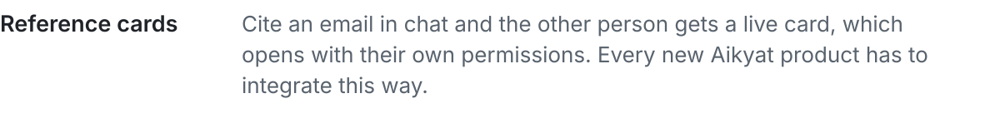
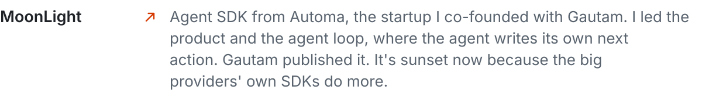
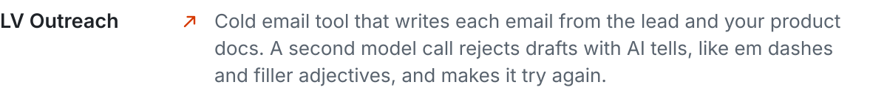
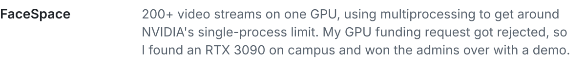
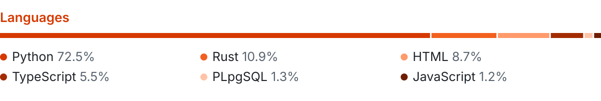

<picture><source media="(prefers-color-scheme: dark) and (max-width: 600px)" srcset="https://raw.githubusercontent.com/Ravi2k3/Ravi2k3/output/hero-dark-mobile.svg"/><source media="(prefers-color-scheme: light) and (max-width: 600px)" srcset="https://raw.githubusercontent.com/Ravi2k3/Ravi2k3/output/hero-light-mobile.svg"/><source media="(prefers-color-scheme: dark)" srcset="https://raw.githubusercontent.com/Ravi2k3/Ravi2k3/output/hero-dark.svg"/></picture>

Reach me on [LinkedIn](https://www.linkedin.com/in/ravi-krishna-661704234/) or by [email](mailto:2003.ravikrishna@gmail.com).

<picture><source media="(prefers-color-scheme: dark) and (max-width: 600px)" srcset="https://raw.githubusercontent.com/Ravi2k3/Ravi2k3/output/now-dark-mobile.svg"/><source media="(prefers-color-scheme: light) and (max-width: 600px)" srcset="https://raw.githubusercontent.com/Ravi2k3/Ravi2k3/output/now-light-mobile.svg"/><source media="(prefers-color-scheme: dark)" srcset="https://raw.githubusercontent.com/Ravi2k3/Ravi2k3/output/now-dark.svg"/></picture>
<picture><source media="(prefers-color-scheme: dark) and (max-width: 600px)" srcset="https://raw.githubusercontent.com/Ravi2k3/Ravi2k3/output/aikyat-mail-dark-mobile.svg"/><source media="(prefers-color-scheme: light) and (max-width: 600px)" srcset="https://raw.githubusercontent.com/Ravi2k3/Ravi2k3/output/aikyat-mail-light-mobile.svg"/><source media="(prefers-color-scheme: dark)" srcset="https://raw.githubusercontent.com/Ravi2k3/Ravi2k3/output/aikyat-mail-dark.svg"/></picture>
<picture><source media="(prefers-color-scheme: dark) and (max-width: 600px)" srcset="https://raw.githubusercontent.com/Ravi2k3/Ravi2k3/output/aikyat-chat-dark-mobile.svg"/><source media="(prefers-color-scheme: light) and (max-width: 600px)" srcset="https://raw.githubusercontent.com/Ravi2k3/Ravi2k3/output/aikyat-chat-light-mobile.svg"/><source media="(prefers-color-scheme: dark)" srcset="https://raw.githubusercontent.com/Ravi2k3/Ravi2k3/output/aikyat-chat-dark.svg"/></picture>
<picture><source media="(prefers-color-scheme: dark) and (max-width: 600px)" srcset="https://raw.githubusercontent.com/Ravi2k3/Ravi2k3/output/reference-cards-dark-mobile.svg"/><source media="(prefers-color-scheme: light) and (max-width: 600px)" srcset="https://raw.githubusercontent.com/Ravi2k3/Ravi2k3/output/reference-cards-light-mobile.svg"/><source media="(prefers-color-scheme: dark)" srcset="https://raw.githubusercontent.com/Ravi2k3/Ravi2k3/output/reference-cards-dark.svg"/></picture>
<picture><source media="(prefers-color-scheme: dark) and (max-width: 600px)" srcset="https://raw.githubusercontent.com/Ravi2k3/Ravi2k3/output/before-dark-mobile.svg"/><source media="(prefers-color-scheme: light) and (max-width: 600px)" srcset="https://raw.githubusercontent.com/Ravi2k3/Ravi2k3/output/before-light-mobile.svg"/><source media="(prefers-color-scheme: dark)" srcset="https://raw.githubusercontent.com/Ravi2k3/Ravi2k3/output/before-dark.svg"/></picture>
<a href="https://github.com/ecstra/moonlight"><picture><source media="(prefers-color-scheme: dark) and (max-width: 600px)" srcset="https://raw.githubusercontent.com/Ravi2k3/Ravi2k3/output/moonlight-dark-mobile.svg"/><source media="(prefers-color-scheme: light) and (max-width: 600px)" srcset="https://raw.githubusercontent.com/Ravi2k3/Ravi2k3/output/moonlight-light-mobile.svg"/><source media="(prefers-color-scheme: dark)" srcset="https://raw.githubusercontent.com/Ravi2k3/Ravi2k3/output/moonlight-dark.svg"/></picture></a>
<a href="https://github.com/Ravi2k3/ai-campaign-personalization"><picture><source media="(prefers-color-scheme: dark) and (max-width: 600px)" srcset="https://raw.githubusercontent.com/Ravi2k3/Ravi2k3/output/lv-outreach-dark-mobile.svg"/><source media="(prefers-color-scheme: light) and (max-width: 600px)" srcset="https://raw.githubusercontent.com/Ravi2k3/Ravi2k3/output/lv-outreach-light-mobile.svg"/><source media="(prefers-color-scheme: dark)" srcset="https://raw.githubusercontent.com/Ravi2k3/Ravi2k3/output/lv-outreach-dark.svg"/></picture></a>
<picture><source media="(prefers-color-scheme: dark) and (max-width: 600px)" srcset="https://raw.githubusercontent.com/Ravi2k3/Ravi2k3/output/facespace-dark-mobile.svg"/><source media="(prefers-color-scheme: light) and (max-width: 600px)" srcset="https://raw.githubusercontent.com/Ravi2k3/Ravi2k3/output/facespace-light-mobile.svg"/><source media="(prefers-color-scheme: dark)" srcset="https://raw.githubusercontent.com/Ravi2k3/Ravi2k3/output/facespace-dark.svg"/></picture>
<picture><source media="(prefers-color-scheme: dark) and (max-width: 600px)" srcset="https://raw.githubusercontent.com/Ravi2k3/Ravi2k3/output/berghain-dark-mobile.svg"/><source media="(prefers-color-scheme: light) and (max-width: 600px)" srcset="https://raw.githubusercontent.com/Ravi2k3/Ravi2k3/output/berghain-light-mobile.svg"/><source media="(prefers-color-scheme: dark)" srcset="https://raw.githubusercontent.com/Ravi2k3/Ravi2k3/output/berghain-dark.svg"/></picture>
<picture><source media="(prefers-color-scheme: dark) and (max-width: 600px)" srcset="https://raw.githubusercontent.com/Ravi2k3/Ravi2k3/output/languages-dark-mobile.svg"/><source media="(prefers-color-scheme: light) and (max-width: 600px)" srcset="https://raw.githubusercontent.com/Ravi2k3/Ravi2k3/output/languages-light-mobile.svg"/><source media="(prefers-color-scheme: dark)" srcset="https://raw.githubusercontent.com/Ravi2k3/Ravi2k3/output/languages-dark.svg"/></picture>

